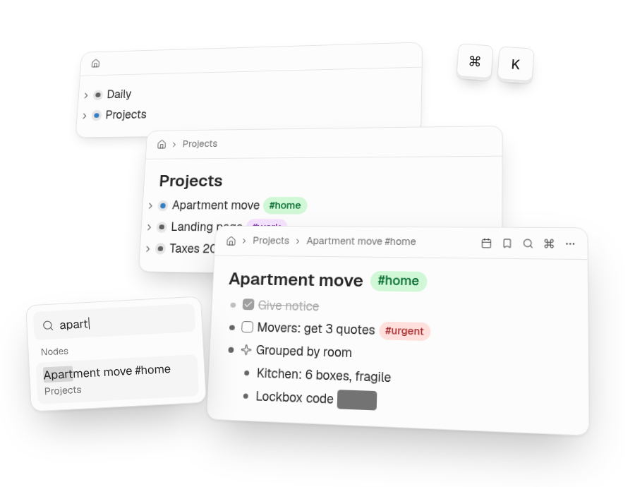
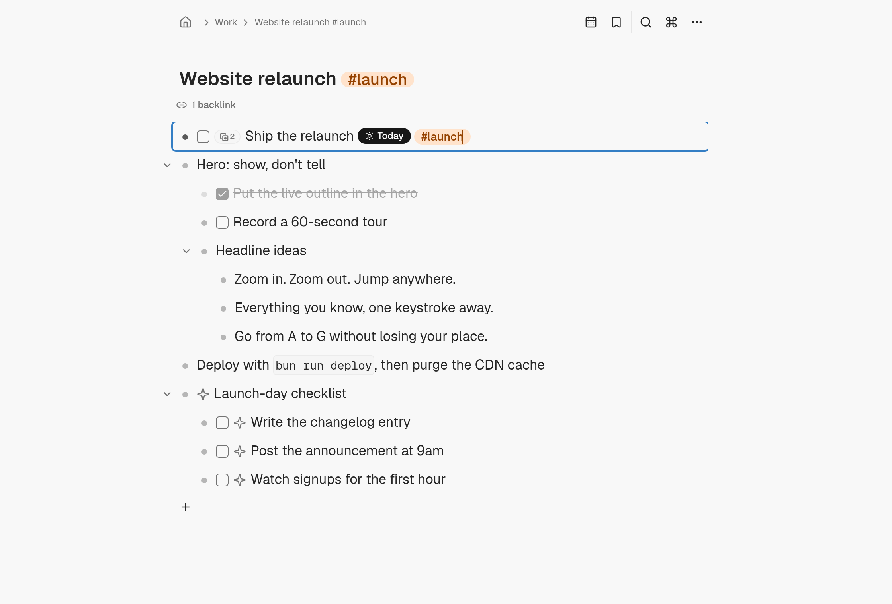

<p align="center">
  <picture>
    <source media="(prefers-color-scheme: dark)" srcset="./public/logo-dark.svg" />
    
  </picture>
</p>

<p align="center">
  <strong>An outliner that moves as fast as you think.</strong><br/>
  Dotflowy keeps your notes, tasks, and ideas in one nested outline.<br/>
  Get everything out of your head, then find it the moment it matters.
</p>

<p align="center">
  <a href="https://app.dotflowy.com"><strong>Start free</strong></a> ·
  <a href="https://dotflowy.com/try">Try the demo</a> ·
  <a href="https://dotflowy.com/changelog">What's new</a>
</p>

<p align="center">
  <a href="https://dotflowy.com/try">
    <picture>
      <source media="(prefers-color-scheme: dark)" srcset="./docs/images/hero-dark.png" />
      
    </picture>
  </a>
</p>

Use Dotflowy in your browser on desktop or phone. Your outline syncs live
across devices. No App Store app is required; you can add it to your home screen.

## Highlights

- **One nested outline.** Nest, collapse, drag, and zoom into any node.
  Choose bullets, tasks, paragraphs, or embeds.
- **Capture without losing your place.** Quick-add a thought to today's
  daily note, then organize it when you're ready.
- **Find what matters.** Filter by `#tags`, connect nodes with `[[links]]`
  and backlinks, or press `Cmd/Ctrl+K` to jump anywhere.
- **Keep one source in several places.** Mirror a node into another part of
  your outline. Edit either instance and both update.
- **Bring your notes, take them with you.** Import OPML from Workflowy.
  Export as OPML or Markdown, and paste nested text as real nodes.
- **Work with your AI agent.** Connect an MCP client or use the CLI. Agent
  changes appear live with attribution; text inside `||spoilers||` reaches
  agents redacted.

<p align="center">
  <a href="https://dotflowy.com/try">
    <picture>
      <source media="(prefers-color-scheme: dark)" srcset="./docs/images/outline-dark.png" />
      
    </picture>
  </a>
</p>

[Try the live demo](https://dotflowy.com/try), no account needed.
For editing commands, see the [keyboard shortcuts](./docs/keyboard.md).

## Coming from Workflowy?

1. In Workflowy, export your outline as OPML.
2. In Dotflowy, import the file. Your nesting comes with it.
3. Keep typing. Enter, Tab, and Shift+Tab work the way you expect.

## AI agents and command line

Connect ChatGPT, Claude, Cursor, or another MCP client through OAuth.
Ask your agent to sort today's notes, plan under a node, or list your open
tasks. Its changes sync into the editor with attribution. Spoiler text is
redacted before it reaches agents, not just hidden visually.

The [MCP guide](./docs/mcp.md) covers connections, tools, and security.
The [Dotflowy CLI](./cli/README.md) uses the same tools, with browser login
and JSON output for scripts. Use Node.js 22.19.0 or newer:

```sh
npm install --global dotflowy
dotflowy login
dotflowy status
```

For commands that target your deployment, open **Settings → Connections →
Command line (CLI)** in the app.

## Hosted plans

- **Free:** 10,000 nodes, with the full editor, import, and export. Reaching
  the limit does not prevent you from reading, editing, or exporting.
- **Unlimited and Founding:** no node limit, plus AI agents over MCP and
  the CLI.

See [current pricing](https://dotflowy.com/) for prices and availability.
Each outline belongs to one person. Sharing and collaboration are not available yet.

## For developers

Dotflowy is a static React SPA built with
[TanStack Start](https://tanstack.com/start) and
[TanStack DB](https://tanstack.com/db). A Cloudflare Worker syncs each user's
outline through a dedicated
[Durable Object](https://developers.cloudflare.com/durable-objects/), with
[Better Auth](https://www.better-auth.com) accounts.

Editor features extend a small core through an
[internal plugin registry](./docs/plugins.md). Plugins are compiled into
the app, not installed at runtime.

### Run it locally

```sh
bun install
bun run setup   # once: secrets + local database schema
bun run cf:dev  # SPA + Worker on port 8787
```

Once the server is running, create a dev account in another terminal:

```sh
bun run seed:user
```

Open http://localhost:8787 and sign in as `dev@dotflowy.local` /
`dotflowy-dev`. Local development needs no Cloudflare account.
See [CONTRIBUTING.md](./CONTRIBUTING.md) for prerequisites, the faster HMR
loop, and testing, or the [deployment guide](./docs/deploying.md) to self-host
on Cloudflare.

## Documentation

| Doc                                      | What's in it                                                                                    |
| ---------------------------------------- | ----------------------------------------------------------------------------------------------- |
| [Architecture](./docs/architecture.md)   | The data model, persistence + sync design, the plugin system, the stack, and the project layout |
| [Deploying](./docs/deploying.md)         | Self-hosting on Cloudflare Workers, auth + signup configuration                                 |
| [Agents (MCP)](./docs/mcp.md)            | Connecting AI agents to your outline over the Model Context Protocol                            |
| [Command line (CLI)](./cli/README.md)    | Installation, browser login, commands, and scripting                                            |
| [Keyboard shortcuts](./docs/keyboard.md) | The full key reference                                                                          |
| [`CONTRIBUTING.md`](./CONTRIBUTING.md)   | Setup, the dev loops, the pre-PR check matrix, repo conventions                                 |
| [`AGENTS.md`](./AGENTS.md)               | Always-on identity, guardrails, and pointers for coding agents                                  |
| [`docs/adr/`](./docs/adr/)               | One decision record per load-bearing choice                                                     |
| [`CHANGELOG.md`](./CHANGELOG.md)         | What's new, release by release                                                                  |

## License

Copyright © FAITH TOOLS SOFTWARE SOLUTIONS, LLC. Released under the
[O'Saasy License](./LICENSE). Source is available for learning, modification,
and self-hosting; offering a competing hosted SaaS product is reserved to the
copyright holder.
